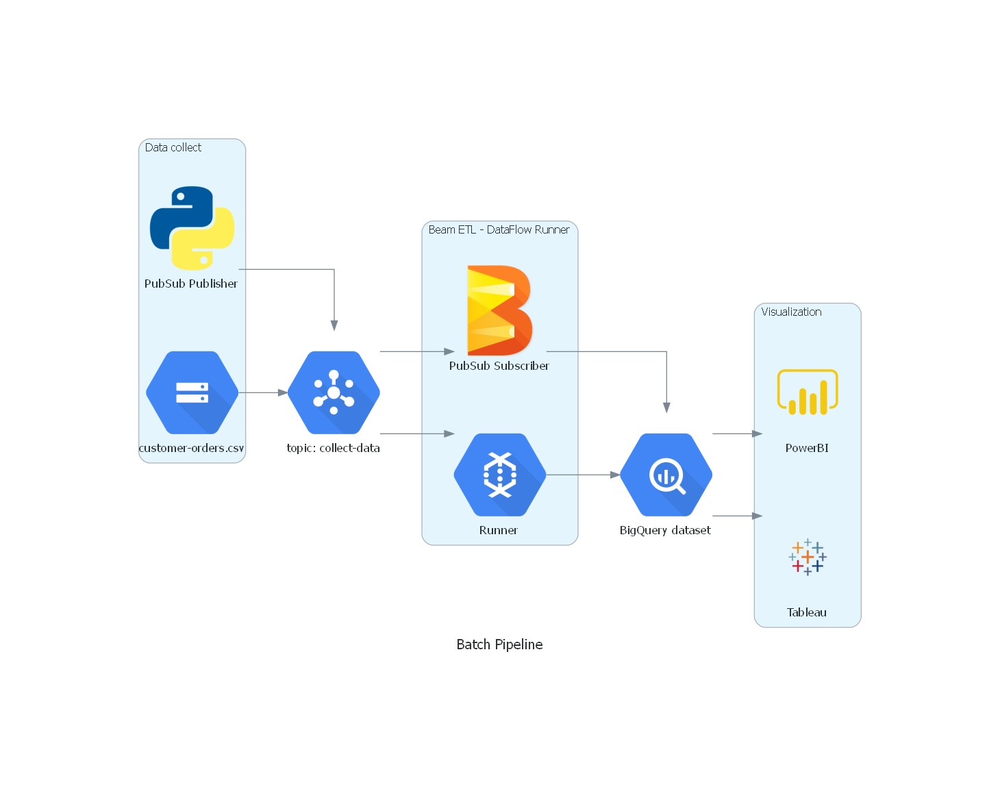

# GCP Batch Pipeline: Cloud Storage → BigQuery

A data pipeline on **Google Cloud Platform** that loads a CSV file of customer orders from **Cloud Storage**, streams it row by row through **Pub/Sub**, writes it to **BigQuery** with an **Apache Beam / Dataflow** job and exposes an aggregated view for a **Looker Studio** dashboard.

> The diagram also shows Power BI and Tableau logos as possible BI tools; this implementation uses **Looker Studio**.

## How it works

1. **Publish**: a Python job downloads `customer-orders.csv` from Cloud Storage with pandas and publishes each row as a JSON message to the Pub/Sub topic `collect-data`.
2. **Process**: an Apache Beam pipeline running on **Dataflow** subscribes to the topic and appends the records to the BigQuery table `dataset_order.order_table` (`customer_id`, `order_id`, `order_amount`).
3. **Serve**: a BigQuery SQL view aggregates the total order amount per customer for the dashboard.

## Repository structure

| File | Content |
| --- | --- |
| `PubSub Publisher - Cloud Storage to PubSub.ipynb` | Reads the CSV from Cloud Storage and publishes the rows to Pub/Sub |
| `Pubsub Subscriber - PubSub to BigQuery.ipynb` | Beam pipeline, from interactive tests to the full Dataflow job writing to BigQuery |
| `BigQuery view for Looker Studio.sql` | Aggregation view used by the Looker Studio dashboard |

## Running it

**Prerequisites:** a GCP project with Cloud Storage, Pub/Sub, Dataflow and BigQuery enabled, a service account with access to them, and the Python packages `google-cloud-storage`, `google-cloud-pubsub`, `apache-beam[gcp]` and `pandas`.

1. Upload your CSV to a Cloud Storage bucket and create the Pub/Sub topic.
2. Update the project ID, bucket, topic and table names in the notebooks.
3. Start the subscriber notebook to launch the Dataflow job, then run the publisher notebook.
4. Create the SQL view in BigQuery and connect Looker Studio to it.
